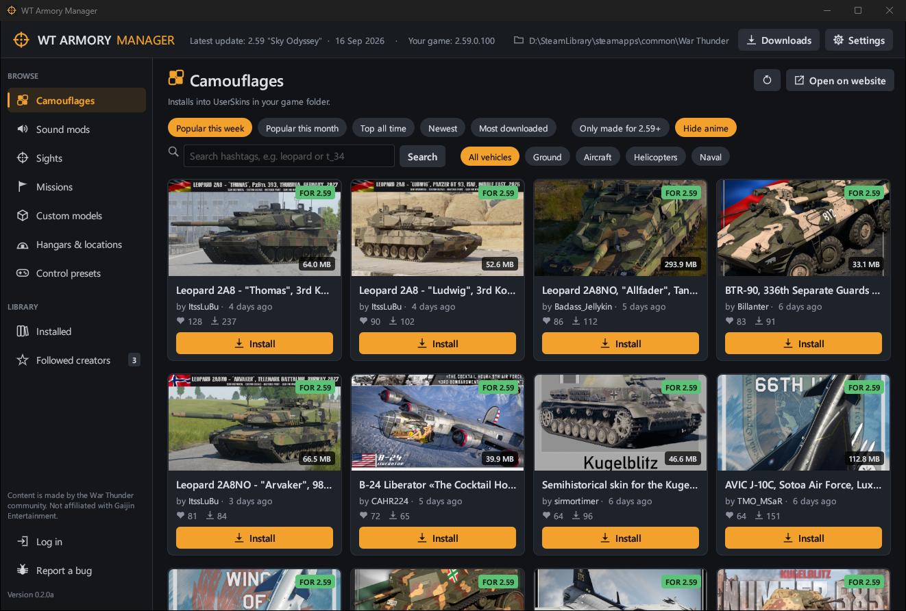
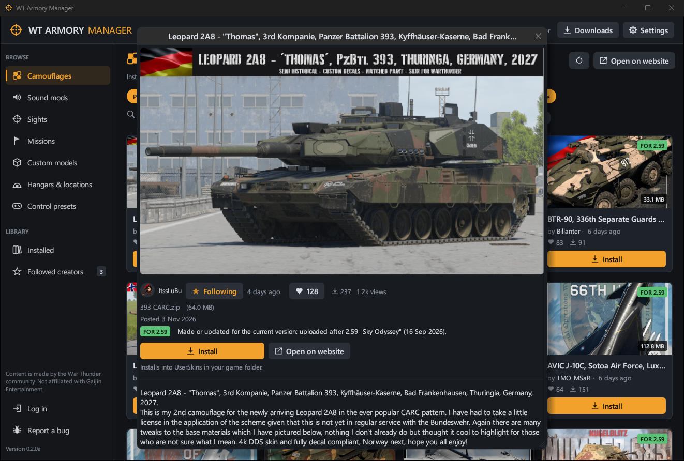
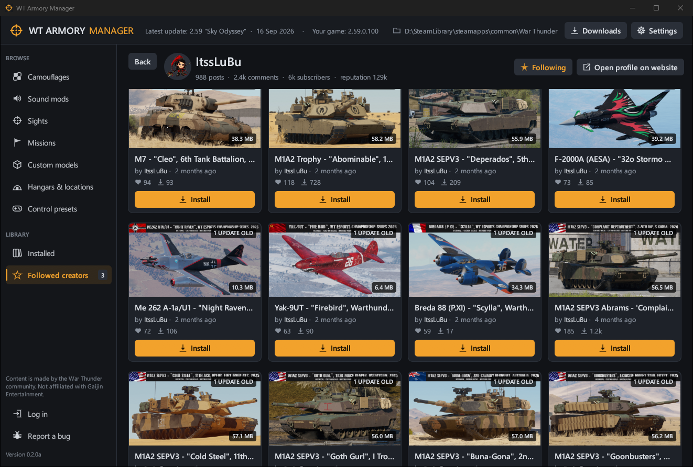
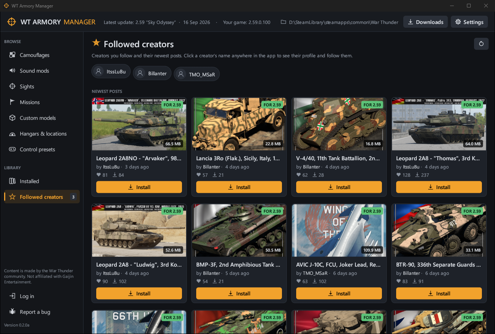

# WT Armory Manager

Browse [live.warthunder.com](https://live.warthunder.com) and install War Thunder community content with one click. You can remove it just as easily. No manual copying of folders and no editing of `config.blk` by hand.

> **Alpha.** This is an early version. Back up anything you care about, and please report problems with the **Report a bug** button in the app (or the Issues tab).



| | |
|---|---|
|  |  |
|  | |

## Features

- **Browse like the website.** Camouflages, sound mods, sights, missions, custom models, hangars and locations, and control presets, with the site's sort orders, hashtag search, a vehicle-type filter for skins, and infinite scrolling.
- **One-click install.** Each type goes where War Thunder expects it:

  | Type | Installed to |
  |---|---|
  | Camouflages | `<game>\UserSkins\<vehicle>` |
  | Sound mods | `<game>\sound\mod`, and turns on `enable_mod:b=yes` in `config.blk` |
  | Sights | `Documents\My Games\WarThunder\Saves\<user ID>\production\UserSights` |
  | Missions | `<game>\UserMissions` |
  | Custom models | merged into the game folder (`content`, `UserMissions`) |
  | Hangars | merged into the game folder; switch them on and off in the app (sets `hangarBlk` in `config.blk`) |
  | Control presets | `Documents\My Games\WarThunder\WT Armory Manager presets` (import in game: Controls > Import from file) |

- **Hangar switch.** After you install a hangar, the app asks before replacing your current one. Each installed hangar gets an on/off switch, and one click on **Use default hangar** brings back the normal hangar.
- **Clean uninstall.** The app removes exactly the files it added, restores any file it replaced, and undoes its `config.blk` changes.
- **Compatibility check.** Each mod is compared with the latest major War Thunder update, read live from the official changelog. A badge shows whether it was made for the current version or how many major updates old it is. There is also a filter to show only up-to-date mods.
- **Download queue.** Click Install on as many mods as you like: two download at a time and the rest wait their turn. The **Downloads** window shows active, waiting and finished downloads with progress and speed, and lets you cancel or retry.
- **Creators.** Click any creator's name to see their profile and all their mods. Follow the ones you like and see their newest posts together under **Followed creators**.
- **Content filter.** **Hide anime** hides anime and itasha skins, detected from their hashtags and franchise names. Posts without those can still slip through, so **Hide creator** lets you hide anyone else.
- **Log in to live.warthunder.com** to like posts and write comments. The login is Gaijin's own login page in a small browser window, so the app never sees your password. Reading comments works without logging in.
- **Updates itself.** The app checks GitHub for a new version at every start, installs it and asks you to restart. You can turn that off in Settings and use **Check for updates** instead.
- **Bug reports** from the app: **Report a bug** opens a pre-filled GitHub issue with your app, Windows and game versions. You check and submit it on GitHub.
- **Finds your game automatically** in the Gaijin launcher folder or any Steam library, or lets you choose the folder yourself.
- **Safe with `config.blk`.** A backup is saved before every change, and the app won't edit the file while the game is running.

## Download

Get the latest `WT-Armory-Manager-<version>.exe` from the [Releases](https://github.com/maxlvl01/wt-armory-manager/releases) page and run it. Nothing needs to be installed. Windows SmartScreen may warn you because the exe isn't code-signed.

## Build from source

Requires [Rust](https://rustup.rs) and the Visual Studio C++ build tools.

```powershell
cargo build --release
.\target\release\WTArmoryManager.exe
```

## Notes

- Only `.zip` archives and single files can be installed automatically. `.rar` and `.7z` posts need to be installed manually.
- The app keeps its data in `%LOCALAPPDATA%\WT Armory Manager`: settings, the list of installed items, backups and, if you log in, your live.warthunder.com session (**Log out** deletes it).
- Logging in needs WebView2, which is part of Windows 10 and 11.
- Self-updating replaces the exe where it is. If it lives in a protected folder such as Program Files, download updates from the Releases page instead.
- Content on live.warthunder.com is made by the War Thunder community. This project is not affiliated with or endorsed by Gaijin Entertainment.

## License

[MIT](LICENSE)
